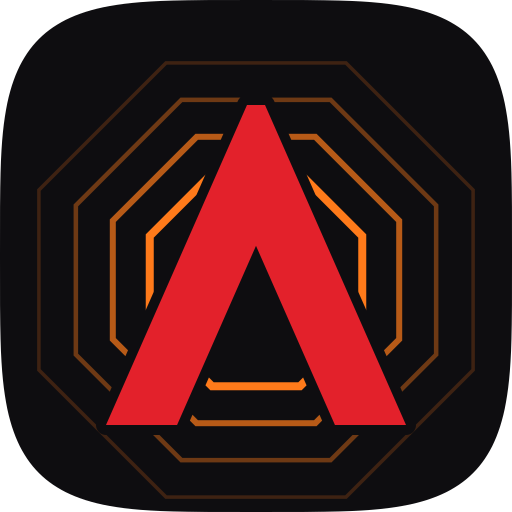

# Asuka

Apps in Go with each platform's own widgets, on iOS, Android, macOS,
Windows, Linux and the web.
Asuka renders with each platform's widgets (UIKit on iOS, Android
Views and Material 3 on Android, AppKit on the Mac, Win32 drawn as
Windows 11's, GTK 4 and libadwaita on Linux, the DOM in a browser) and
updates them with fine-grained signals: a change touches only the views
that read it.

> [!WARNING]
> **Alpha.** Asuka is pre-1.0 and changes daily. There is no API
> stability, no backwards compatibility, and no migration guide yet.

```go
func Counter() ui.Node {
	count := signal.New(0)
	label := signal.Func(func() string {
		return fmt.Sprintf("Count: %d", count.Get())
	})
	return ui.SafeArea(ui.Style{Align: ui.AlignCenter, Justify: ui.JustifyCenter},
		ui.Text(label),
		ui.Button(ui.ButtonProps{
			Title:   ui.Val("Add"),
			Variant: ui.ButtonFilled,
			OnPress: func() { count.Set(count.Peek() + 1) },
		}),
	)
}

func main() { app.Run(Counter) }
```

- **Native controls**: stacks and tabs with the platform's navigation,
  lists, text fields, pickers, sheets, alerts, menus, web views, video,
  and your own native views.
- **Motion**: animations, transforms, enter and exit transitions, shared
  elements, gestures.
- **Languages**: typed messages from ICU catalogs that follow the language as
  it changes, CLDR's plurals, numbers and dates, and right-to-left layouts that
  mirror with no code.
- **Batteries**: SQLite with live queries, secure storage, the camera and
  code scanning, photos, location, notifications, audio.
- **`asuka dev`**: your Go code reloads on save, the app's state kept: on
  the simulator, an emulator or a phone (the Go code runs on your
  computer), in a browser, or as a window on your Mac, PC or Linux
  machine.
- **`asuka build`**: a signed `.ipa` for the App Store, and an `.aab` for
  Google Play; **`asuka publish`** uploads them, numbered after the store's
  last build, to TestFlight (its groups, App Review) or a Play track.
- **macOS**: the same app on AppKit, in one Go process
  (`asuka dev --platform mac`, `asuka build --platform mac`).
- **Windows**: the same app on Win32 and the common controls,
  drawn as Windows 11's, in one Go process (`asuka dev --platform windows`,
  `asuka build --platform windows`).
- **Linux**: the same app on GTK 4 and libadwaita, called
  without cgo, in one Go process (`asuka dev --platform linux`, `asuka build
  --platform linux`: a folder to install, a `.tar.gz` and a Flatpak
  manifest, from any system).
- **The web**: the same app in a browser, its Go code compiled to
  WebAssembly and its views the page's DOM, placed where Asuka's layout
  puts them (`asuka dev --platform web`, `asuka build --platform web`: a static site). See
  [the web](docs/web.md).

## Quick start

You need Go 1.26 or later, and for phones Xcode (iOS) or Android Studio
with an NDK (Android). The Mac, Windows and the web need nothing more,
Linux GTK 4.14 and libadwaita 1.5; see [Getting
started](docs/getting-started.md).

```sh
go install github.com/egoist/asuka/cmd/asuka@latest
asuka new hello
cd hello
asuka dev --platform ios     # or android, web; on a Mac, PC or Linux, asuka dev alone runs it there
```

See [the documentation](docs/README.md) for the guides, and
[`examples`](examples) for apps: [`gallery`](examples/gallery) shows
every component. The documentation is also in
[Chinese](docs/zh/README.md) (中文文档).

## License

MIT
